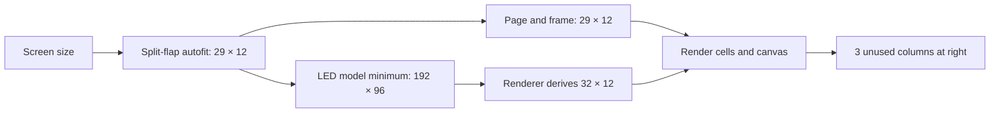

# TV panel pixel geometry investigation

Date: 2026-10-24. Status: research and proposed repair; no product changes applied.

## Experience requirement

Keep character-based page authoring. The user wants LED TV panels to use their display end to end, like Divoom, without extra unusable columns. This is more than making the existing `fill_tv` decoration look different: the usable content must reach the intended display extent.

The proposed long-term direction is a Divoom-style pixel surface with square LEDs and a character grid derived from it. This interprets the user's Divoom comparison; the follow-up choice between grid adjustment and nonuniform stretching remains open. That choice affects page migration and the geometry owner; it must not be hidden in a CSS patch.

## Confirmed on the running FiestaPi

Read-only inspection of authenticated APIs on 2026-10-24; server reports 9.14.9. No display settings, pages, schedules, or output were changed. Authentication material is excluded from this report.

| Layer | Apple TV Matrix Test |
|---|---|
| Panel settings | 55-inch screen, 16:9, LED matrix, calibration 1 |
| Configured character grid | 29 columns × 12 rows |
| Saved pages used by the active collection | 29 × 12 |
| Live integer and rich-cell frames | Exactly 12 rows, each 29 cells |
| Public model and board model | 192 × 96 pixels, `5x7` font |
| Font pitch, including spacing | 6 × 8 pixels |
| Character capacity inferred by renderer | 32 × 12 |
| Presentation setting | `matrix_sizing: null` (viewer default) |

Endpoints inspected: `/api/health`, `/api/panels`, `/api/settings/board`, `/api/panel/{id}`, `/api/panel/{id}/frame`, `/api/v1/boards/{id}`, `/api/pages`.

The renderer has three more character columns than the page and frame. The engine and output plugin have not lost three columns: they receive and preserve the configured 29. The model advertises a different surface.

The live WoW pages also deliberately reserve a 9-column × 9-row portrait at the top left, indent their upper text by ten spaces, and use `fill_space` before right-hand values. The live canvas bounds were x=0, y=0, width=53, height=71, matching that area. This explains the right-hand text layout in the sampled page. It does not establish that every reported alignment symptom has the same cause. The extra right-hand columns are a separate confirmed geometry defect.

## Root cause and propagation

1. `src/panels/autofit.py::compute_autofit_grid` uses physical split-flap character pitch. Creation, resizing, and startup reconciliation use that grid for both render styles.
2. `src/fiestaui/__init__.py::fiestapanel_model` computes `width=max(192, cols*6)` and `height=max(96, rows*8)`. This preserves the example model's old minimum even when the actual panel is smaller.
3. `src/outputs/board_profile.py::board_model_spec` and `src/panels/routes.py::get_panel_public` publish this model. `src/outputs/first_party.py` binds it to the runtime. Thus previews, runtime display profiles, and clients inherit the same mismatch.
4. FiestaUI `layoutLedCellGrid` derives its grid from pixel dimensions and font, then copies each supplied row from column zero and pads missing cells. This produces right-hand blank columns; it does not center a smaller page within the larger cell grid.
5. Swift `MatrixRaster` and Kotlin `MatrixRaster` likewise derive character capacity from pixels. Fixing browser CSS alone leaves native clients and canvas placement wrong.
6. `web/src/components/panel/panel-matrix-editor-preview.tsx` independently repeats the 192/96 minimum and 6/8 pitch. The unsaved settings preview can preserve the bug even after a server-only fix.

The minimum was retained in FiestaBoard commit `deca52140` / PR #2290, which fixed growth beyond the original face. `test_resized_matrix_contains_the_complete_board_in_every_public_model` explicitly expects 29 columns to retain a 192-pixel face. That test checks growth to 40 columns, not equality between authored and rendered grids.

## Reproduced geometry matrix

Executed the actual Python autofit, model resolver, and LED grid-layout functions at FiestaBoard `62b69eca1`:

| Screen | Authored grid, columns × rows | Advertised pixels | Python raster grid | Outcome |
|---|---|---|---|---|
| 32″ | 17 × 7 | 192 × 96 | 32 × 12 | 15 extra columns, 5 extra rows |
| 43″ | 22 × 9 | 192 × 96 | 32 × 12 | 10 extra columns, 3 extra rows |
| 55″ | 29 × 12 | 192 × 96 | 32 × 12 | 3 extra columns |
| 65″ | 34 × 14 | 204 × 112 | 34 × 14 | Grids agree |
| 75″ | 40 × 16 | 240 × 128 | 40 × 16 | Grids agree |
| 85″ | 45 × 18 | 270 × 144 | 42 × 18 | Pixel width silently clamped to 256 |
| 100″ | 53 × 22 | 318 × 176 | 42 × 22 | Pixel width silently clamped to 256 |
| 200″ | 106 × 44 | 636 × 352 | 42 × 32 | Both axes silently clamped to 256 |

These are function-level reproductions, not physical-device or full browser end-to-end tests.

## Related defects and compatibility constraints

### Canvas boundaries disagree with page boundaries

`src/canvas/layer.py::render_canvases` obtains a pixel-derived grid. `src/canvas/geometry.py::area_rect` applies right bleed only when the area reaches that grid's final column. A full 29-column page on the 32-column raster does not qualify.

Verified by calling `area_rect`: a 55-inch full-page canvas with `bleed: all` covers 173 × 96 of the advertised 192 × 96. A hypothetical exact 174 × 96 surface produces 29 × 12 cells and the canvas covers the whole 174 × 96. The same exact-surface checks passed for 32, 43, 65, and 75 inches. An 85-inch surface still needs the renderer limit repaired.

### Pixel capacity is inconsistent

Python `src/led/matrix.py` and the pinned FiestaUI **v8.13.1** `src/lib/led-matrix.ts` clamp pixel dimensions to 256. The inspected Kotlin decoder, raster, and presentation layout also use 256. Swift permits 2048 and has an old-server expansion fallback. FiestaBoard's character limit is 128 columns × 96 rows, which can require 768 × 768 pixels with this font.

Do not solve this by merely increasing one constant. Decoder, renderer, layers, transitions, preview backing canvas, payload limits, and memory budgets must agree. Reject unsupported geometry explicitly; do not silently discard content. Existing physical LED models retain their actual hardware dimensions.

### “Fill TV” currently fills decoration, not content

Web `PanelMatrix` and native matrix layout use a uniform contain scale. `fill_tv` adds unlit dots outside that source rectangle. It cannot add usable page columns and does not stretch content to both screen edges. `fit_panel` retains a visible content rectangle. `true_size` limits pitch using physical screen measurements.

`null` means viewer default: the browser takes a legacy inset/bezel path, whereas native clients may use their locally selected presentation, commonly Fill TV. A preview cannot promise identical outer presentation when it has not been told the viewer's local preference. Content geometry must still agree.

### Configuration and frame are fetched separately

Existing stale-shape guards reject frames after character-grid changes. A pixel-layout change that keeps the same character grid can still leave old canvas layers or a client configuration/frame race. Test and invalidate these together; a geometry identity shared by config and frame is an option if current invalidation/refetch behavior cannot make the transition safe.

## Ownership

| Component | Responsibility in the repair |
|---|---|
| FiestaPanel configuration / core | Resolve one effective geometry; decide character versus pixel authority; apply resizing and compatibility rules consistently in create/update/startup |
| Template and canvas engines | Lay out text and canvases against that same resolved grid; preserve authored alignment; invalidate geometry-dependent caches |
| FiestaPanel output plugin | Accept the resolved frame shape and preserve rich cells/layers; avoid independent screen sizing or presentation calculations |
| FiestaUI | Own reusable glyph metrics and layout rules, supported pixel bounds, and cross-language fixtures; do not decide a household TV's product settings |
| FiestaBoard web | Use the resolved geometry in page builder, live preview, settings draft, and viewer; distinguish cells from pixels and decorative background |
| Apple TV / Android TV | Consume geometry faithfully, honor defined presentation modes, detect incompatible frames, and remove unneeded model-specific size guesses |

The pinned output plugin (`cb4c4727691e60fe660decb74be33de117bc58dd`) validates the configured frame and stores it through core's pull-delivery path. It does not rasterize or create the three extra columns. A plugin rewrite is not indicated by this evidence.

## Approaches evaluated

1. **Exact surface from existing character grid.** For the current panel, derive 174 × 96 from 29 × 12 and the 6 × 8 pitch. Preserves pages and is a small, compatible geometry repair. It needs an explicit stretch policy if filling both edges of an arbitrary TV is required; uniform fitting may leave margins.
2. **Divoom-style pixel surface authority.** Resolve a virtual LED surface from the panel's screen shape and density, then derive all usable character cells from that surface and font. Character-based authoring stays. Pixel canvas bleed can reach the surface edge. This needs deliberate page refitting when switching style or changing density, and safeguards for shared pages and collections.
3. **Explicit smaller content viewport inside the old minimum.** Requires viewport coordinates in all renderers and canvas calculations. It preserves an unnecessary 192 × 96 minimum and does not satisfy end-to-end usable content by itself. Do not pursue for this bug.

Jev advisory review initially favored approach 1 under a page-preservation priority. The user's subsequent clarification prioritizes Divoom-like end-to-end use. That clarification takes precedence; the final choice must account for it rather than treating the earlier advisory answer as approval.

## Implementation sequence common to either viable approach

1. Add a regression fixture from the confirmed 29 × 12 frame / 192 × 96 model mismatch. Include first/last-column markers, a full-width rule, a portrait beside text, and an all-edge-bleed canvas. Keep user data out of fixtures.
2. Define the geometry invariant and exact sizing semantics, including legacy `null`, before changing consumers. Share fixtures for font metrics, cell counts, pixel bounds, and origin.
3. Establish supported raster capacity across FiestaUI, Python, Swift, and Kotlin. Test beyond 256, maximum supported surfaces, and rejection outside the supported envelope. Release renderer support before server changes requiring it.
4. Route create, resize, startup reconciliation, board model/profile, plugin binding, and canvas rendering through the canonical resolver. Retain API compatibility where possible.
5. Remove duplicated draft-preview math. Use server preview resolution or a pure shared algorithm with the same fixtures. A draft resize must render the page for its proposed grid, or clearly identify the old frame; it must not quietly relabel old cells as a new preview.
6. Align browser and native presentation. Preserve square pixels or stretch only according to the selected policy. Do not fake usable screen coverage with background dots.
7. Release with explicit migration/rollback behavior. Do not resize shared pages by matching dimensions alone; use the active page, collection, and schedule references to identify impact.
8. Run the acceptance matrix below, then verify the real FiestaPi panel without changing its content beyond an explicitly approved test/migration.

## Recommended staged repair and product decisions

Stage A fixes the demonstrated defect without changing saved page sizes: derive the legacy panel's exact surface from its character grid and font metrics. For the live 55-inch panel this is 174 × 96. This removes phantom columns and repairs canvas boundaries, but uniform fitting alone is not a promise of edge-to-edge TV coverage. Do not present Stage A as the entire experience fix.

Stage B introduces an explicit pixel-authoritative TV layout. The virtual pixel surface matches the configured screen aspect; the font determines its usable character grid, as on Divoom. The UI exposes screen shape and text density, with columns × rows reported as a result. Pixel dimensions belong in advanced details. Physical screen inches, calibration, and `matrix_pitch_mm` remain presentation inputs; they do not silently resize pages. This avoids changing page compatibility when someone merely calibrates their TV.

An initial density proposal for a 16:9 TV is 192 × 108 pixels at 5×7, yielding 32 × 13 usable characters. This is a design candidate, not a measured optimum or a chosen user setting. It preserves the familiar 192-pixel width while correcting the aspect, and stays within older 256-pixel raster limits. Test readability at real viewing distance before pinning presets. Character gutters may leave a few margin pixels, just as on Divoom; the pixel surface itself fills the screen, and all-edge canvas bleed reaches it. No whole addressable character columns remain outside the page. Portrait and other aspect presets must use the same declared density policy rather than unrelated constants.

Recommended migration policy:

- Upgrading alone preserves existing page sizes and applies Stage A. It does not automatically convert users to a new density or rewrite their templates.
- Converting a panel to Stage B generates a proposed replacement set for its referenced pages and collections. Preserve original pages and reference mappings for rollback; clone shared collections before changing their page references. Do not infer page ownership merely from matching dimensions.
- For an enlargement on both axes, preserve explicit canvas areas and literal text positions in the proposed copies, while allowing expressions such as `fill_space` to use the new width. `PageService._scale_canvases_on_retarget` currently scales areas automatically if `canvases` is omitted: the migration must supply the intended areas explicitly. Proportional canvas scaling can otherwise make a 9-column portrait overlap text still indented by ten literal spaces.
- Shrinkage or a mixed grow/shrink resize requires a preview showing clipping and canvas/text relationships before applying. No silent crop and no claim that arbitrary templates can be semantically reflowed.
- A conversion must validate the complete reference graph before activation. Failure keeps the original panel geometry and references active. Use a recoverable operation/backup so a crash between page creation and reference changes does not strand the display.
- Rollback restores the original geometry and reference mapping while retaining newly edited converted copies. It must not restore an old backup over subsequent user edits.

Recommended presentation/compatibility policy:

- Keep legacy `null` as viewer-local preference and existing `fill_tv` semantics on legacy panels. Label the preview accordingly. Do not silently reinterpret an installed client's saved setting.
- New pixel-authoritative panels use an explicit panel-owned default presentation. All current clients and previews use that setting. A local override, if retained, must be visible as an override rather than implying exact preview parity.
- New square-pixel surfaces have the screen's aspect, so uniform scaling fills that matching viewport. A viewer on a different aspect uses contain and reports the mismatch; it must not crop or distort silently. Exact integer dimensions and rounding rules are part of the density specification.
- No required new wire viewport is needed for the 55-inch correction: current model pixel dimensions already carry it. Geometry-changing config/frame pairs still need coordinated invalidation and refresh.
- Stay within the oldest supported renderer's capacity until support is released and the installed clients are verified. Do not enable a larger preset merely because the server accepts it. Treat greater-than-256 support as a separate compatibility milestone with a stated minimum client version or explicit capability check.

The builder review identified migration, density, older clients, presentation defaults, and rollback as the five consequential gaps. The policies above are the proposed answers. Preset density/readability and the user's final stretch-versus-grid preference remain product decisions; they do not block the confirmed Stage A repair from being planned precisely.

## Acceptance criteria

- Page size picker, preview, live frame, model-derived cell grid, and native renderers agree on every usable character position.
- Edge markers occupy the first and last usable columns. A full-page canvas with all-edge bleed reaches all four pixel boundaries.
- Right-aligned values align to the last usable column. Portrait placement does not add a hidden offset to surrounding content.
- 32/43/55/65/75/85-inch presets, portrait, 4:3, and ultrawide shapes; include grids above the current 256-pixel limit.
- Rich-cell and legacy message paths, blank/no-frame state, canvas-only updates/removal, transitions, calibration, reconnect, and resize while polling.
- `fill_tv`, `fit_panel`, `true_size`, and legacy `null` have explicit, tested semantics. Screen drift/protection never pushes edge content offscreen.
- Divoom 64 × 64 at 3×5 and 5×7, split-flap panels, and physical Vestaboards retain their correct geometry.
- Migration respects collections, schedules, and shared pages; restarting does not undo the chosen LED geometry; rollback restores compatible saved data.
- A native-device/browser comparison uses the same synthetic fixture and checks actual edge pixels, not just component visibility or request success.

## Evidence scope

FiestaBoard source: `62b69eca1`; web dependency pin: `@fiestaboard/ui 8.13.1`, inspected from its local Git tag. Native source inspected in local `fiestaboard-tvos` (`41754e3`), `fiestaboard-appletv` (`a3df9c9`), and `fiestaboard-androidtv` (`3f811c1`) checkouts. These establish implementation behavior, not the exact native build installed on the user's television. No native build number or on-device visual capture was obtained.

The focused Python probes passed; full repository suites and native/device acceptance tests have not been run. This document does not claim the bug is fixed.

## Approved implementation and verification follow-up

The user approved approach 2: independent pixel-authoritative LED sizing while retaining physical split-flap sizing and character-based authoring. Implementation is on `codex/panel-led-sizing`; the research above records the evidence and alternatives before that decision.

The canonical server resolver now uses aspect-matched bounded surfaces (16:9: 192 × 108), Large 5×7 or Small 3×5 text, and exact legacy surfaces without the minimum that introduced phantom columns. Draft preview and saved output consume that same result. Existing panels retain their saved grid; explicit conversion can copy only referenced content for the target board, preserving originals and canvas cell areas. A durable journal protects multi-store conversion and refuses recovery over later conflicting edits. Same-character-grid pixel changes invalidate the runtime's render cache; failed saves retain the last displayed frame.

Synthetic contract fixture: `tests/fixtures/panel-led-geometry.json`. Python and pinned FiestaUI checks cover derived grids/origins, corner glyphs, and all-edge canvas coverage. Additional compiled probes used actual native core source, without modifying either native repository:

- Swift `fiestaboard-tvos` at `41754e3344c818c0784de29f5d80be15906adfc3`: all six fixture surfaces, corner glyphs, and complete decoded RGBA canvas coverage passed. Its old-server containing-cell-grid fallback did not expand these surfaces.
- Kotlin `fiestaboard-androidtv` at `3f811c1ef4f482d8d5b812703079c3bbc8550457`: all six fixture surfaces and corner glyphs passed. Its current `PanelFrame`/`Wire.frame`/`MatrixRaster` path does not consume canvas layers; the probe confirmed that a valid full-surface layer is ignored. This is an existing native feature gap, separate from the extra-column geometry defect.
- Probe source and output were saved locally under `/tmp/fiestaboard-native-sizing-probe/`. These are renderer/decoder checks, not installed-build identification or physical-TV validation.

The browser settings and pixel-delivery acceptance tests run against an isolated local server and mock board. No live FiestaPi configuration or page was changed, and no native release was built or deployed. Real viewing-distance readability and an installed Apple TV/Google TV comparison remain release acceptance work.
